<div align="center">

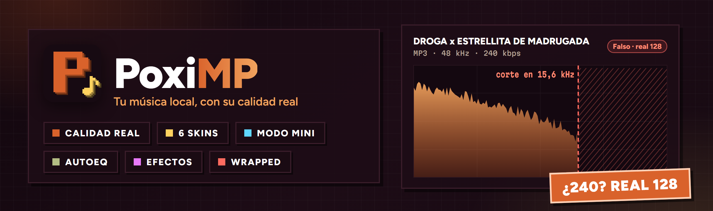

<br />


**🇪🇸 Español** · [🇬🇧 English](#-english)

### Tu música local, con su calidad **real**.

Un reproductor ligero que **te dice si cada archivo es lo que promete**: ese MP3 «320» que en realidad es un 128,
ese FLAC que salió de un MP3… Lo analiza solo, por detrás, mientras escuchas.

</div>

---

## 🎯 Qué es

**PoxiMP** es un reproductor para tu música de siempre, la que tienes en el PC: gratis, sin cuentas, sin anuncios y
sin suscripciones. Tiene todo lo que esperas de un reproductor serio (cola, listas, ecualizador, sin pausas entre
canciones, atajos, modo mini) y algo que no tiene ningún otro: **mira el espectro de cada canción y te avisa cuando
su calidad es falsa**.

Está hecho en **Rust** con Tauri: el instalador pesa 6 MB, arranca al momento y apenas gasta memoria aunque tengas
miles de canciones.

## 📸 Así se ve

<table>
  <tr>
    <td colspan="2">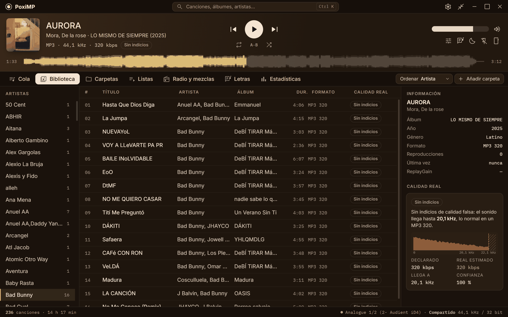</td>
  </tr>
  <tr>
    <td colspan="2" align="center"><sub>🎵 Tu biblioteca con la calidad real de cada canción, la forma de onda y el informe de calidad a la derecha</sub></td>
  </tr>
  <tr>
    <td width="50%">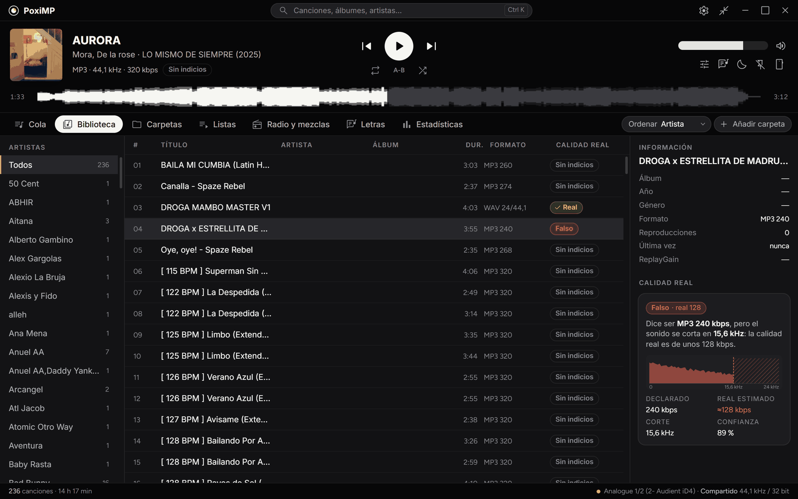</td>
    <td width="50%">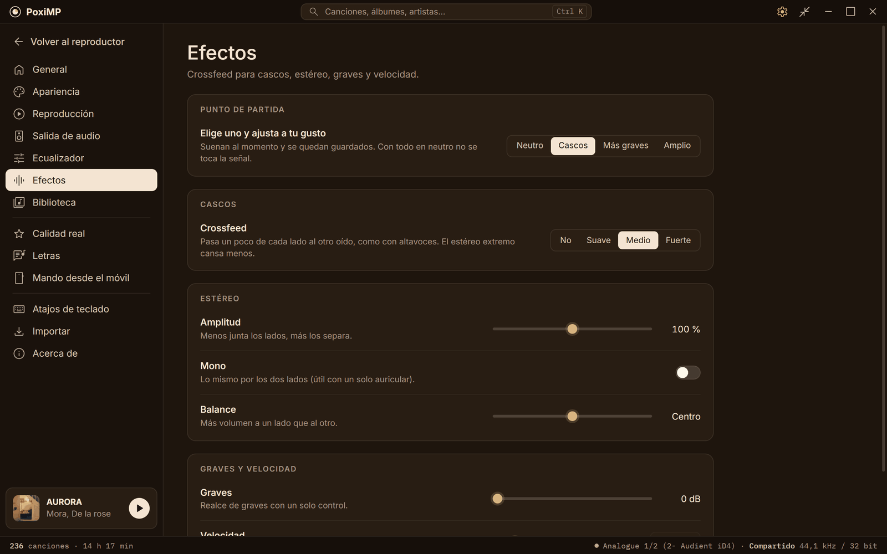</td>
  </tr>
  <tr>
    <td align="center"><sub>🔍 Un «240 kbps» que corta en 15,6 kHz: en realidad es un 128</sub></td>
    <td align="center"><sub>🎛️ Efectos: crossfeed para cascos, estéreo, graves y velocidad</sub></td>
  </tr>
  <tr>
    <td colspan="2">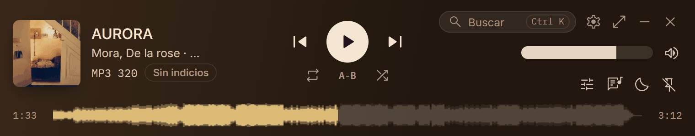</td>
  </tr>
  <tr>
    <td colspan="2" align="center"><sub>🪟 Modo mini: la misma ventana encogida al reproductor, siempre encima y con buscador</sub></td>
  </tr>
</table>

### 🎨 6 skins, todo en el mismo sitio

<table>
  <tr>
    <td width="50%">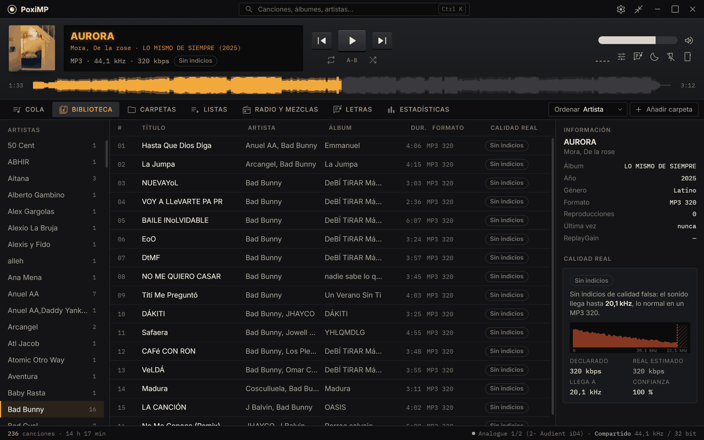</td>
    <td width="50%">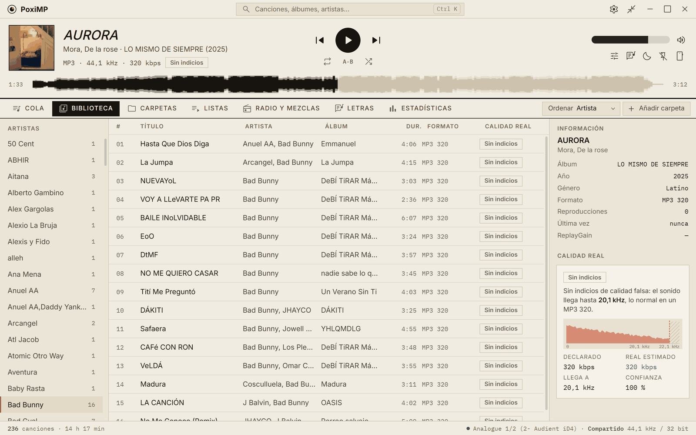</td>
  </tr>
  <tr>
    <td align="center"><sub>📼 Pletina: hi-fi de los 80</sub></td>
    <td align="center"><sub>💿 Portada: clara, de contraportada de vinilo</sub></td>
  </tr>
  <tr>
    <td width="50%">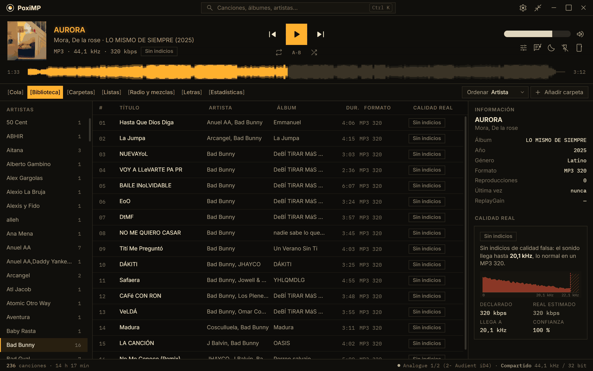</td>
    <td width="50%">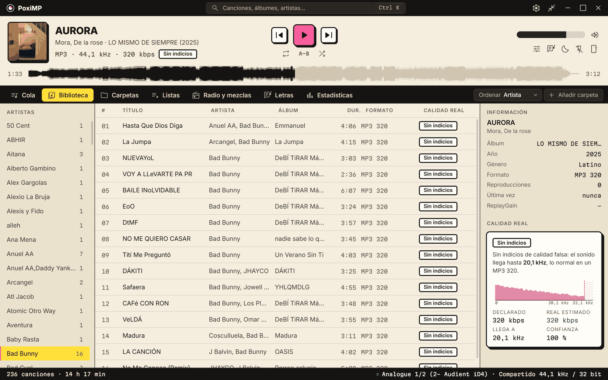</td>
  </tr>
  <tr>
    <td align="center"><sub>🟧 Fósforo: pantalla de fósforo</sub></td>
    <td align="center"><sub>🧱 Ruido: neo-brutalista</sub></td>
  </tr>
  <tr>
    <td width="50%">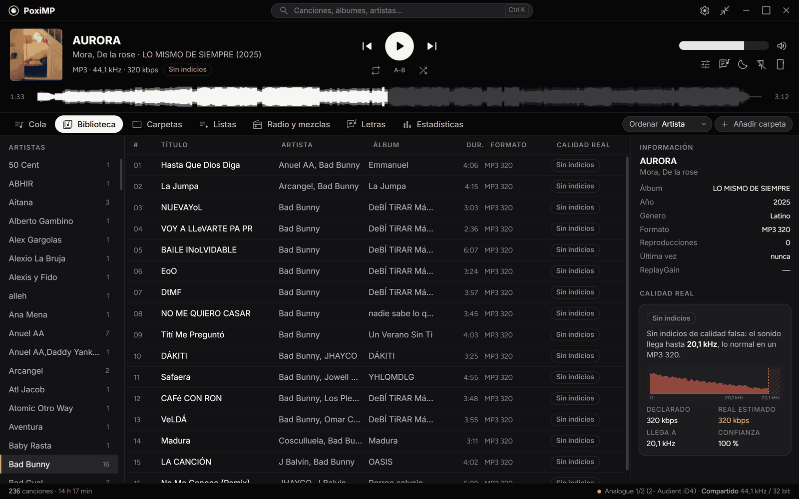</td>
    <td width="50%">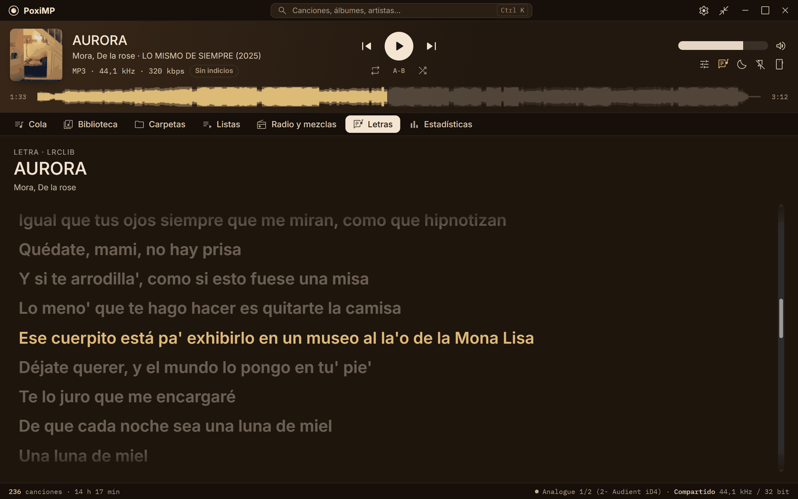</td>
  </tr>
  <tr>
    <td align="center"><sub>🖤 Stream: estilo plataforma de streaming</sub></td>
    <td align="center"><sub>🎤 Letras sincronizadas que siguen la canción</sub></td>
  </tr>
</table>

## 📥 Descarga

### **[⬇️ Descargar PoxiMP 1.0.0 para Windows](https://github.com/PoxiiTV/PoxiMP/releases/download/v1.0.0/PoxiMP-Setup-1.0.0.exe)** · **[🍎 para Mac](https://github.com/PoxiiTV/PoxiMP/releases/download/v1.0.0/PoxiMP-1.0.0-mac-arm64.dmg)**

Instalador de 6 MB: crea los accesos, abre tus MP3 y FLAC con doble clic y **se actualiza solo**. Sin administrador.

| Archivo | Para qué |
|---|---|
| **[`PoxiMP-Setup-1.0.0.exe`](https://github.com/PoxiiTV/PoxiMP/releases/download/v1.0.0/PoxiMP-Setup-1.0.0.exe)** | **Instalador** (Windows): accesos, iconos por formato, «Abrir con PoxiMP» y actualizaciones automáticas |
| [`PoxiMP-1.0.0-portable.exe`](https://github.com/PoxiiTV/PoxiMP/releases/download/v1.0.0/PoxiMP-1.0.0-portable.exe) | **Portable** (Windows): se abre tal cual, sin instalar nada. Al actualizar, se instala en tu PC |
| [`PoxiMP-1.0.0-mac-arm64.dmg`](https://github.com/PoxiiTV/PoxiMP/releases/download/v1.0.0/PoxiMP-1.0.0-mac-arm64.dmg) | **Mac** con chip Apple (M1 o posterior): arrástralo a Aplicaciones. También se actualiza solo |

Todas las versiones y sus novedades, en [**Releases**](https://github.com/PoxiiTV/PoxiMP/releases).
Requiere **Windows 10 u 11 de 64 bits** o **macOS 11 o posterior** en un Mac con chip Apple.

> ℹ️ Como aún no está firmado con un certificado, el sistema puede avisarte la primera vez:
> - **Windows** (aviso azul de SmartScreen): **Más información → Ejecutar de todas formas.**
> - **Mac** («no se puede verificar el desarrollador»): **Ajustes del Sistema → Privacidad y seguridad → Abrir igualmente.**
>   Si dice que la app «está dañada», en Terminal: `xattr -cr /Applications/PoxiMP.app`
>
> El código está entero aquí.

---

## 🌟 Lo que lo hace distinto

| | |
|---|---|
| 🔍 **Calidad real** | Analiza el espectro de cada archivo en segundo plano y marca los falsos: **bitrate inflado** (*«Falso · real 128»*), **lossless que viene de un MP3** (*«Viene de MP3»*) y **Hi-Res falso** (24 bits que son 16, 96 kHz que vienen de 44,1). Nunca llama «auténtico» a un MP3: como mucho, *«Sin indicios»* |
| 🎨 **6 skins** | **Cara A** (toma los colores de la portada), **Pletina**, **Portada** (clara y oscura), **Fósforo**, **Ruido** y **Stream**. Todo está en el mismo sitio en todas, como en AIMP: cambias de skin sin perderte y sin cortar la música |
| 🪟 **Modo mini** | La misma ventana encogida al reproductor (`Ctrl+M`), siempre encima, con buscador y la calidad real a la vista: *«Real 128 kbps»* en rojo si el archivo engaña |
| 🌊 **Forma de onda real** | La barra de progreso dibuja la forma de onda de cada canción, calculada en tu PC |
| 🎁 **Wrapped de tu música** | Tu año en canciones, artistas, horas y rachas, con tu música local |
| 📥 **Vente desde AIMP o iTunes** | Tus listas, reproducciones y valoraciones, sin perder nada |

## 🎧 Sonido

| | |
|---|---|
| 🎚️ **Ecualizador paramétrico** | 10 bandas (campana, graves, agudos, paso bajo y alto), presets y preamp automático para que nunca sature |
| 🔎 **AutoEq** | Busca tus cascos dentro de la app y aplica su corrección de AutoEq |
| 🎛️ **Efectos** | **Crossfeed** para cascos (suave, medio, fuerte), **amplitud estéreo**, **mono**, **balance**, **graves** con un solo control y **velocidad** tipo tocadiscos (0,5× a 1,5×) |
| 🎯 **Bit-perfect** | WASAPI exclusivo al formato de cada archivo, sin tocar un bit. Y eliges la salida de audio |
| 🔀 **Sin pausas o con crossfade** | Gapless de verdad; crossfade opcional que nunca corta dentro de un mismo álbum |
| 🔊 **Normalización opcional** | Por canción o por álbum, o *«solo subir las flojas»*. Apagada por defecto |
| ✅ **Fiel por defecto** | Con el EQ plano y los efectos en neutro, la señal sale **intacta** |

## 📚 Tu biblioteca

| | |
|---|---|
| ⚡ **Rápida con miles de canciones** | Búsqueda al instante que ignora tildes, buscador global (`Ctrl+K`) y **varios artistas** bien separados |
| 📁 **Carpetas** | Vista de carpetas y, con clic derecho, **quita** una carpeta o subcarpeta de la biblioteca sin tocar los archivos |
| 📋 **Listas inteligentes** | Con reglas anidadas: *«lo que no escucho hace dos años y nunca salté»* |
| 📻 **Radio y mezclas** | Por cómo suena tu música, calculadas en tu PC, sin internet ni cuentas |
| 🎤 **Letras sincronizadas** | De las etiquetas, de un `.lrc` o de LRCLIB; pulsa una línea para saltar ahí |
| ⏯️ **Recuerda por dónde ibas** | En sesiones largas y audiolibros |
| 📊 **Estadísticas** | Lo que más escuchas por semana, mes y año |

## ☕ Para el día a día

| | |
|---|---|
| 🖱️ **Doble clic y suena** | Cada formato con su propio icono. Lo que abres desde fuera suena sin meterse en tu biblioteca |
| 📱 **Mando desde el móvil** | Escanea un QR y controla la música desde el sofá, por tu WiFi y sin apps: lo que suena, la cola y la búsqueda |
| ⌨️ **Teclas multimedia** | Panel del sistema y atajos globales a tu gusto |
| 🔍 **Escala** | Toda la interfaz del 80 al 150 % |
| 🌍 **Español e inglés** | Y la letra neutra en todas las skins si la prefieres |
| 💿 **Todos tus formatos** | MP3, FLAC, WAV, AIFF, ALAC, AAC/M4A, OGG Vorbis, Opus, WavPack y APE |

## 🔄 Siempre al día

- **Se actualiza solo:** al abrirse y cada 10 minutos mira si hay versión nueva; con un clic se descarga, se instala **y se vuelve a abrir**.
- **Novedades dentro de la app** la primera vez que abres cada versión.
- Desde el **portable**, la actualización instala PoxiMP en tu PC.

## 🛡️ Privacidad

- 🏠 **Todo pasa en tu PC.** No hay cuentas ni servidor propio, y no envía nada de lo que escuchas.
- 🌐 Solo se conecta para comprobar si hay versión nueva (GitHub), buscar letras en LRCLIB (se puede apagar) y la lista de AutoEq cuando la buscas.
- 📱 El mando del móvil viene **apagado**, funciona solo en tu red local y pide un código.
- ✅ Las actualizaciones van **firmadas**: PoxiMP solo instala las que vienen de su autor.

## ❓ Preguntas

- **¿Cómo sabe que un MP3 es falso?** Un MP3 de 320 kbps guarda sonido hasta unos 20 kHz; uno de 128, solo hasta unos 16. Si un «320» corta en 16 kHz, alguien lo convirtió desde un 128: el espacio extra no trae más música.
- **¿Toca mis archivos?** Nunca. Lee las etiquetas y el sonido; lo suyo (valoraciones, reproducciones, listas) lo guarda aparte.
- **¿Puedo quitar una carpeta?** Sí: clic derecho en **Carpetas → Quitar de la biblioteca**, o la ✕ en **Ajustes → Biblioteca**. Los archivos se quedan donde están.
- **¿Por qué mi antivirus lo marca?** Es un falso positivo de un programa nuevo y sin certificado de firma. Si te pasa, avísame en [Issues](https://github.com/PoxiiTV/PoxiMP/issues).

---

## 🔧 Compilar

Necesitas [Node.js](https://nodejs.org) 20 o superior, [Rust](https://rustup.rs) (stable, MSVC) y CMake (para Opus).

```bat
start.bat       :: modo desarrollo
deploy.bat      :: Windows: instalador firmado, portable y latest.json en deploy-hosting\
```

En un **Mac con chip Apple** (con Node, Rust, CMake y, para subirlo, [`gh`](https://cli.github.com)):

```bash
./build-mac.sh          # dmg, actualización firmada y latest.json en deploy-hosting/
./build-mac.sh --subir  # lo mismo y lo sube a la release de esa versión
```

Primero se publica la release desde Windows y después se añade la de Mac: el script descarga su `latest.json`
y le suma el Mac, así las dos plataformas se actualizan con el mismo archivo.

Antes de cada commit:

```bat
cargo test --workspace && cargo clippy --workspace
npx tsc --noEmit -p . && npm test
```

Variables del `.env` (no se sube nunca al repo):

| Variable | Qué es |
|---|---|
| `TAURI_SIGNING_PRIVATE_KEY` | Clave privada que firma las actualizaciones (la pública va en `tauri.conf.json`). En Mac, por defecto `~/.tauri/poximp.key` |
| `TAURI_SIGNING_PRIVATE_KEY_PASSWORD` | Su contraseña |

### 🗃️ Estructura

```
crates/poximp-engine/    motor de audio: decodificación, gapless, crossfade, EQ, efectos y salida (bit-perfect)
crates/poximp-quality/   detector de calidad real y forma de onda
crates/poximp-library/   biblioteca (SQLite): escaneo, búsqueda, listas, estadísticas, radio
crates/poximp-codecs/    WavPack y APE
src-tauri/               la app: comandos, cola, mando del móvil, actualizaciones
src/                     la interfaz (React + TypeScript), skins y textos en ES/EN
```

## 🙏 Gracias a

- **[Symphonia](https://github.com/pdeljanov/Symphonia)**, **[cpal](https://github.com/RustAudio/cpal)** y **[rubato](https://github.com/HEnquist/rubato)**: decodificar, sonar y remuestrear.
- **[Lofty](https://github.com/Serial-ATA/lofty-rs)** y **[SQLite](https://sqlite.org)**: etiquetas y biblioteca.
- **[AutoEq](https://github.com/jaakkopasanen/AutoEq)** de Jaakko Pasanen: las correcciones de cascos.
- **[LRCLIB](https://lrclib.net)**: las letras sincronizadas.
- **[bs2b](https://bs2b.sourceforge.net/)** de Boris Mikhaylov: los filtros del crossfeed.
- **[Tauri](https://tauri.app)** y **[Material Symbols](https://fonts.google.com/icons)**.

## 📜 Licencia

[PolyForm Noncommercial 1.0.0](LICENSE).

Puedes **usarlo, estudiarlo, modificarlo y compartirlo libremente** mientras el uso **no sea comercial**: uso
personal, aprendizaje, proyectos de aficionado, centros educativos y organizaciones sin ánimo de lucro.

¿Tu propia versión? Adelante, pero **cambia el nombre, el logo y la clave de firma** por los tuyos.

<div align="center">

---

hecho con 🧡 por [poxi](https://github.com/PoxiiTV)

</div>

---

<div align="center">

## 🇬🇧 English

### Your local music, with its **real** quality.

</div>

**PoxiMP** is a lightweight music player for the music on your PC that **tells you whether each file is what it
claims to be**: that "320" MP3 that is really a 128, that FLAC that came from an MP3… It checks quietly in the
background while you listen. Free, no accounts, no ads, no subscriptions. Built with **Rust** and Tauri: a 6 MB
installer that starts instantly.

### 📥 Download

**[⬇️ Download PoxiMP 1.0.0 for Windows](https://github.com/PoxiiTV/PoxiMP/releases/download/v1.0.0/PoxiMP-Setup-1.0.0.exe)**:
shortcuts, double-click to open your files and **automatic updates**, no admin rights. There is also a
**[portable](https://github.com/PoxiiTV/PoxiMP/releases/download/v1.0.0/PoxiMP-1.0.0-portable.exe)** exe.
Windows 10 or 11, 64-bit. The `.exe` is not code-signed yet: on the blue SmartScreen warning, click
**More info → Run anyway**.

**[🍎 Download for Mac](https://github.com/PoxiiTV/PoxiMP/releases/download/v1.0.0/PoxiMP-1.0.0-mac-arm64.dmg)**
with an Apple chip (M1 or later), macOS 11 or later: drag it to Applications; it updates itself too. It is not
notarized yet: the first time, go to **System Settings → Privacy & Security → Open Anyway**. If it says the app
"is damaged", run `xattr -cr /Applications/PoxiMP.app` in Terminal.

### 🌟 What makes it different

- 🔍 **Real quality**: spectrum analysis of every file flags fakes: inflated bitrate (*"Fake"*, really 128 kbps), lossless made from an MP3 and fake Hi-Res. It never calls an MP3 "genuine": at most, *"no signs"*.
- 🎨 **6 skins**: Cara A, Pletina, Portada (light and dark), Fósforo, Ruido and Stream, with everything in the same place on every one.
- 🪟 **Mini mode** (`Ctrl+M`): the same window shrunk to the player, always on top, with search and the real quality in view.
- 🌊 **Real waveform** in the seek bar, and a **Wrapped** of your local music.
- 📥 **Move over from AIMP or iTunes** keeping your playlists, play counts and ratings.

### 🎧 Sound

- 🎚️ 10-band parametric EQ with presets and auto preamp, plus built-in **AutoEq** for your headphones.
- 🎛️ **Effects**: headphone crossfeed, stereo width, mono, balance, bass boost and turntable-style speed.
- 🎯 **Bit-perfect** (WASAPI exclusive) and output device choice; true gapless or an optional crossfade.
- ✅ With a flat EQ and neutral effects, the signal is left **untouched**.

### 📚 Library and everyday use

- ⚡ Instant accent-insensitive search, global search (`Ctrl+K`), folder view and proper multiple artists. Right-click a folder to remove it from the library (files stay).
- 📋 Smart playlists, similarity **radio and mixes** computed on your PC, **synced lyrics**, stats, and it remembers where you left off.
- 📱 **Phone remote** over your Wi-Fi via QR, no app needed. Media keys, global shortcuts and interface scale (80–150 %).
- 💿 MP3, FLAC, WAV, AIFF, ALAC, AAC/M4A, OGG Vorbis, Opus, WavPack and APE.

### 🔄 Always up to date

It checks for a new version when it opens and every 10 minutes; one click downloads it, installs it and opens it
again, and the first launch shows what's new. Updates are **signed**.

### 🛡️ Privacy

Everything happens on your PC: no accounts, no server of its own, nothing about what you play is sent anywhere. It
only connects to check for updates (GitHub), look up lyrics on LRCLIB (can be turned off) and fetch the AutoEq list
when you search it.

### 🔧 Building

Requires Node.js 20+, Rust (stable, MSVC) and CMake (for Opus). Run `start.bat` for development and `deploy.bat` for
the signed installer, the portable exe and `latest.json` in `deploy-hosting\`. The update signing key goes in `.env`
(`TAURI_SIGNING_PRIVATE_KEY`, `TAURI_SIGNING_PRIVATE_KEY_PASSWORD`), never in the repo.

On an Apple Silicon Mac, `./build-mac.sh` builds the dmg, the signed update and `latest.json`; `--subir` uploads
them to the release of that version. Publish from Windows first: the script downloads the release's `latest.json`
and adds the Mac to it, so both platforms update from the same file.

### 📜 License

[PolyForm Noncommercial 1.0.0](LICENSE).

You can **use, study, modify and share it freely** as long as it's **not commercial**: personal use, learning,
hobby projects, schools and non-profits.

Your own version? Go ahead, but **change the name, logo and signing key** to your own.

<div align="center">

---

made with 🧡 by [poxi](https://github.com/PoxiiTV)

</div>
